# ComfyUI Enhancement Utils

Quality-of-life tools for ComfyUI: a resource monitor, per-node timings, node search, a data-flow visualizer, auto-arrange, and a few handy nodes.

[Like it? Buy me a coffee on Ko-fi](https://ko-fi.com/phazei) · [More nodes by phazei](#more-nodes-by-phazei)

Everything works **inside subgraphs** and in both the **classic and Nodes 2.0** renderers. Most features have options under **Settings > EnhUtils**, each explained by its tooltip.

| Feature | What it does |
|---------|--------------|
| [Resource Monitor](#resource-monitor) | CPU, RAM, GPU, VRAM, temperature and power bars in the menu, with history graphs |
| [Flow Visualizer](#flow-visualizer) | Shows the order data flows through a workflow, and replays the last run |
| [Node Profiler](#node-profiler) | Shows how long each node took |
| [Profiler Timing](#profiler-timing) *(node)* | Node timings as numbers you can use in the workflow |
| [Load Image (With Subfolders)](#load-image-with-subfolders) *(node)* | Load images from subfolders or any folder, with their metadata |
| [Node Navigation](#node-navigation) | Search for any node and jump to it; follow the running node |
| [Graph Arrange](#graph-arrange) | Auto-layout for the graph you're viewing |
| [Play Sound](#play-sound) *(node)* | Plays a sound when the workflow reaches it |
| [System Notification](#system-notification) *(node)* | Browser notification when the workflow reaches it |
| [Parse JSON](#parse-json-enhutils) *(node)* | Turns JSON text into data other nodes can use |
| [Execution Gate](#execution-gate-enhutils) *(node)* | Skips the rest of a branch when a boolean is false |

## Features

### Resource Monitor

Live system stats as coloured bars in the menu bar.

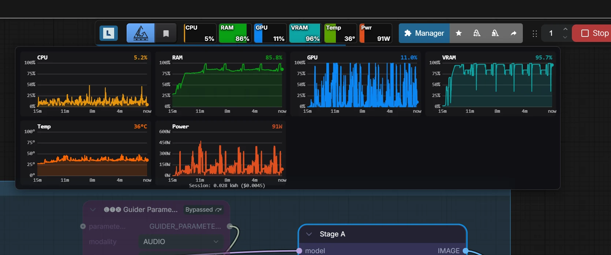

- Hover a bar to see its recent history; click to see every graph at once.
- Tracks this session's electricity cost (set your rate in the settings).
- Full GPU stats on NVIDIA. AMD and Intel GPUs show VRAM only.

<details>
<summary>More details</summary>

| Bar | Shows |
|-----|-------|
| **CPU** | Utilization |
| **RAM** | Used / total |
| **Disk** | Space used on a chosen drive |
| **IO** | How busy the busiest disk is, like Task Manager's Disk %. Off by default (**Show disk I/O activity**) |
| **GPU** | Utilization (NVIDIA only) |
| **VRAM** | Used / total, with the peak in the tooltip |
| **Temp** | GPU temperature |
| **Power** | Current watts (bar = % of the power limit) |

- History is kept by the server, so it survives a browser refresh (not a ComfyUI restart). Pick how much to show in the settings (5 min to unlimited); right-click the bars to clear it.
- Hide any bar, or pick which drive to show, in **Settings > EnhUtils > Monitor**. Hide them all if you only want the other features; setting **Update rate** to 0 also stops collecting stats.
- Only GPUs ComfyUI can use are shown (respects `CUDA_VISIBLE_DEVICES`). Without a usable GPU, only CPU, RAM and disk are shown.
- NVIDIA stats need `nvidia-ml-py`, which is usually already installed with PyTorch.

</details>

---

### Flow Visualizer

**Right-click the canvas > Flow visualization > Show**, or right-click a node > **Trace flow from here**.

An overlay that shows the order data flows through a workflow, so you can understand a graph without tracing noodles.


https://github.com/user-attachments/assets/d69b8faf-c642-4e33-8100-8a6a7535331e


- Nodes and links are coloured by step, from red (start) to violet (end), and pulses travel along the links.
- Greys out what won't run, and marks switches and the nodes that depend on them.
- Select nodes to highlight everything connected to them.
- **Show last run**: see what actually ran, was cached, skipped, failed, or has changed since, and replay it step by step.

#### Show last run

**Flow visualization > Show last run** shows what really happened in the last run, and plays it back step by step.

https://github.com/user-attachments/assets/1dd604bc-3aee-423a-ac0f-2da600f32377


**What did I change since the last run?** Nodes you've edited get a **Δ**. Hover it to see exactly what changed -- handy when you've been tweaking and forgot what you touched.

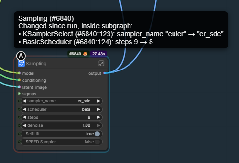

<details>
<summary>How it works</summary>

- **Colours** -- each node's colour comes from how far it is from the start. A long red-to-violet link is something made early and used late (e.g. a VAE). Small arrows along each link show which way data flows.
- **Hidden connections** -- Set/Get nodes and [Use Everywhere](https://github.com/chrisgoringe/cg-use-everywhere) are followed and drawn as dashed links. Reroutes, bypassed nodes and subgraphs are followed too, and it works with links hidden.
- **Greyed out** -- muted nodes, branches that don't reach an output, and outputs that would fail because a required input is cut off.
- **Switches** -- nodes that only run the branch they pick get a diamond badge. Nodes that may not run because of a switch get a faded outline and a **?**. Select one to see which switch it depends on; right-click > **Go to gating switch** jumps there.
- **While running** -- the running node gets a white pulsing ring.
- **Tooltips** -- hover any badge to see what it means.
- Lines are drawn over nodes; **Flow visualization > Draw lines under nodes** puts them underneath.
- Colours, pulse speed, line width, dimming and replay length can be changed in **Settings > EnhUtils > Flow**.
- Also available as commands you can give a shortcut: **Toggle flow visualization**, **Toggle last run (flow visualization)**.

</details>

<details>
<summary>Last run and replay</summary>

**Flow visualization > Show last run** shows the most recent run instead of the prediction:

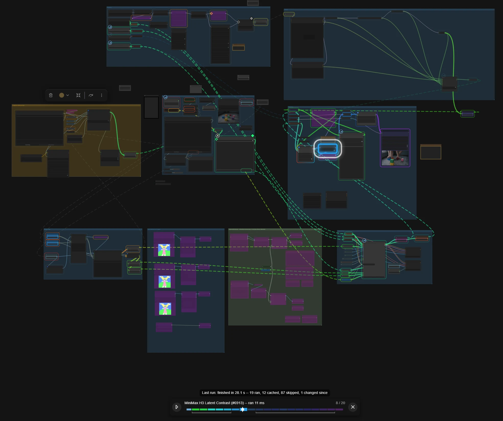

| Badge | Meaning |
|-------|---------|
| ↺ | Cached -- reused from an earlier run |
| ⊘ | Blocked |
| ! | Failed or interrupted (hover for the error) |
| Δ | Changed since the run (hover to see what changed, e.g. `steps 20 → 33`) |

Skipped nodes are greyed out. It updates live while a workflow runs.

**Replay** -- the bar at the bottom plays the run back in the order it actually ran. Drag along the timeline to scrub; click the step name to go to that node. Brackets under the timeline mark steps inside a subgraph.

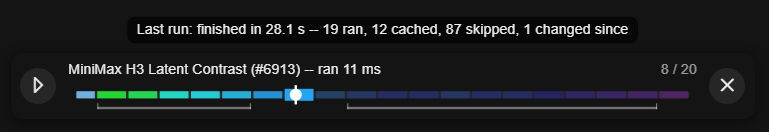

Keys (when the bar has focus): **Space** play/pause, **Left/Right** step, **Home/End** start/end, **Esc** leave the subgraph or close.

Notes:
- Fast nodes are stretched so you can see them, and slow ones are shortened, so the replay isn't real time.
- ComfyUI doesn't finish one branch before starting another, so branches interleave.
- The record is kept by the server: it survives a browser refresh, not a ComfyUI restart. A run from a different workflow isn't shown.

</details>

<details>
<summary>Limitations</summary>

- The live overlay shows the graph's structure. It can't predict which branch a switch picks, or nodes that expand while running (loops). Use **Show last run** for that.
- Nodes that add links by rewriting the prompt when queued aren't followed.
- Copies of the same subgraph share one colouring inside it.
- **Changed since run** ignores seed widgets that change after queueing, and dynamic-prompt text (`{a|b}`).
- Runs queued through the API without a client id aren't recorded.

</details>

---

### Node Profiler

Shows how long each node took, in a badge above it.

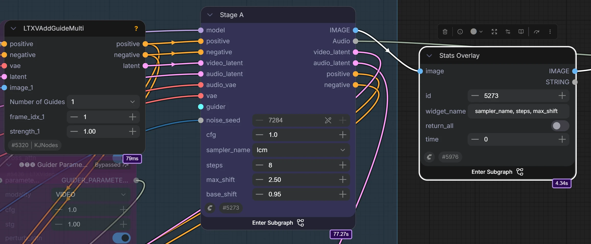

- The running node counts up live.
- Subgraphs show the total time of everything inside them.
- Badges stay until the next run, even through a browser refresh.

<details>
<summary>More details</summary>

Badges inside a subgraph:

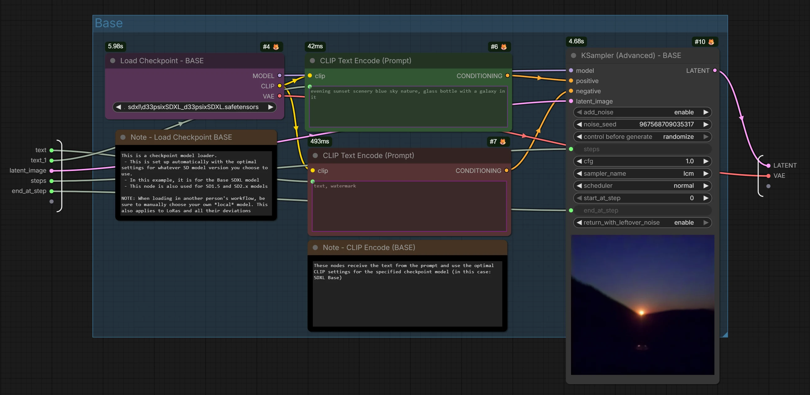

- A summary is also printed to the server console after each run.
- Both can be turned off in **Settings > EnhUtils > Profiler**.
- To use timings inside a workflow, see the [Profiler Timing](#profiler-timing) node.

</details>

---

### Profiler Timing

Outputs how long nodes took, as numbers you can use in the workflow (for logging, file names, and so on).

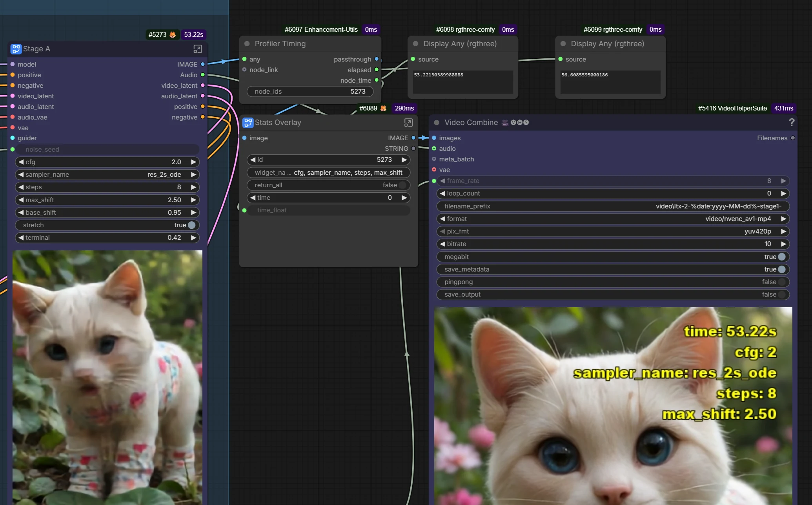

- **elapsed** -- how long the workflow has been running when it reaches this node.
- **node_time** -- how long the nodes you pick took: link one to `node_link`, list IDs in `node_ids`, or both (they're added together).

<details>
<summary>Inputs and outputs</summary>

| Input | Description |
|-------|-------------|
| any | Put the node in line; the value passes through unchanged. This controls when it runs. |
| node_link | Connect any output of a node to time that node |
| node_ids | Node IDs to time, comma-separated (e.g. `43,32:234`). A subgraph's ID gives the total of everything inside it. |

| Output | Description |
|--------|-------------|
| passthrough | The `any` input, unchanged |
| elapsed | Seconds since the run started |
| node_time | Seconds taken by the chosen node(s), added together. 0 for cached nodes. |

A plain ID like `54` used inside subgraph `123` looks for `123:54` first, then deeper inside `123`, then `54` at the top level.

</details>

---

### Load Image (With Subfolders)

Like Load Image, but it also shows images in subfolders, can load from any folder on disk, and outputs the image's embedded metadata (prompt, workflow) as JSON.

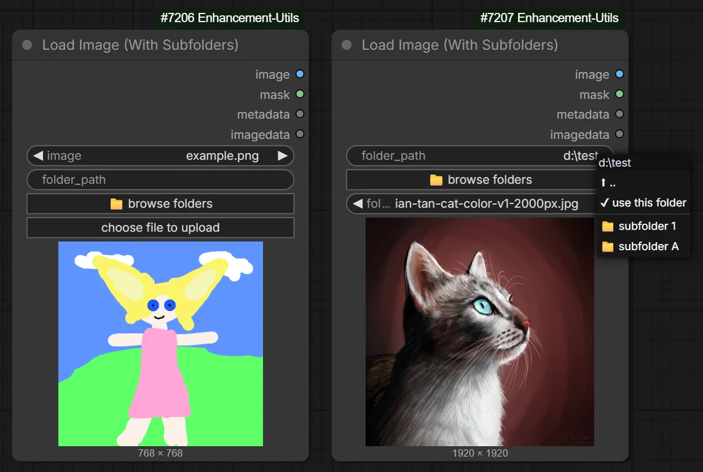

- Pick from the input folder with `image`, or fill in `folder_path` and pick with `folder_image`.
- The **📁 browse folders** button lets you pick a folder instead of typing it.
- Preview, MaskEditor and paste work in both modes.

<details>
<summary>Inputs and outputs</summary>

| Input | Description |
|-------|-------------|
| image | An image from the input folder (subfolders shown as `sub/image.png`) |
| folder_path | Any folder, or one relative to the input folder. When set, `folder_image` is used instead of `image`. |
| folder_image | An image from `folder_path` |

| Output | Description |
|--------|-------------|
| image | The image. Animated and multi-page images give all frames. |
| mask | From the alpha channel (empty if there isn't one) |
| metadata | Embedded metadata as JSON, including `prompt` and `workflow`. Read from PNG, WebP, AVIF and JPEG. `{}` if none. |
| imagedata | File info as JSON: `filename`, `path`, `width`, `height`, `resolution`, `size_bytes` |

- Only re-runs when the file actually changes.
- Handles truncated files, 16-bit images and palette transparency.
- Use [Parse JSON](#parse-json-enhutils) to pull values out of `metadata`.
- **Changed in v1.3.0:** the separate `prompt` output was removed; the prompt is now inside `metadata`.

</details>

<details>
<summary>Restricting folders (shared servers)</summary>

By default, `folder_path` can read any folder the ComfyUI server can. On a shared or `--listen` server you'll probably want to limit that. It's set on the server, so people using the UI can't change it.

Rename `allowed_folders.rename.txt` (in this node pack's folder) to `allowed_folders.txt`:

| `allowed_folders.txt` | Allowed |
|---|---|
| Missing (default) | Any folder |
| Empty | Only the ComfyUI input folder |
| One folder per line | Those folders and their subfolders, plus the input folder |

- Lines starting with `#` are comments. Relative paths are relative to the input folder.
- Changes apply right away, no restart. Updates don't overwrite the file.
- Or set the `ENHUTILS_ALLOWED_FOLDERS` environment variable to a comma-separated list (same rules; set but empty = input folder only). If both are set, a folder must be allowed by both.

</details>

---

### Node Navigation

Right-click the canvas for **Go to node...**, **Follow execution** and **Show executing node**.

#### Go to node

Search for any node by name, type or number, and jump straight to it -- even deep inside subgraphs.

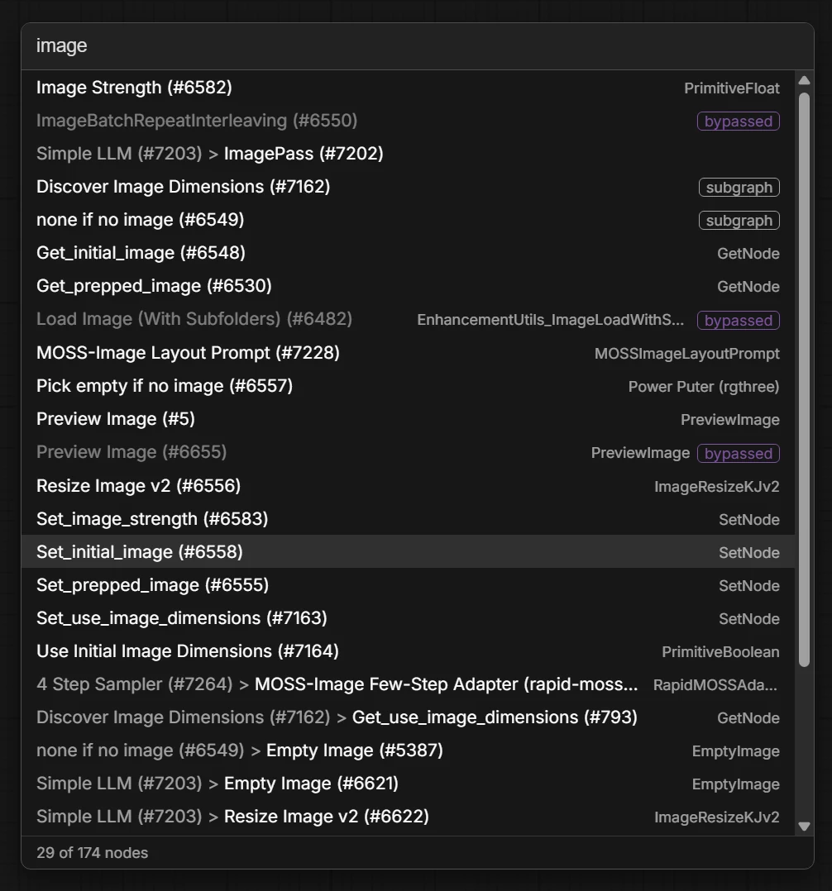

<details>
<summary>Search tips</summary>

- Type a node number (`12` or `#12`), a subgraph path (`5:12`), or part of a title or type.
- A subgraph's name also lists everything inside it. `5:` lists only what's in subgraph #5; `5: vae` searches within it.
- Click a renamed node's original type on the right (or the funnel icon) to list every node of that type. Click a `subgraph` badge to list its contents. **Tab** does the same for the highlighted row.
- Up/Down to pick, Enter or click to jump, Esc to close.
- Also available as the **Search graph nodes** command, so you can give it a shortcut.

</details>

#### Follow execution

Turn it on and the canvas follows the running node as the workflow runs, opening subgraphs as needed. The running node gets a green border.

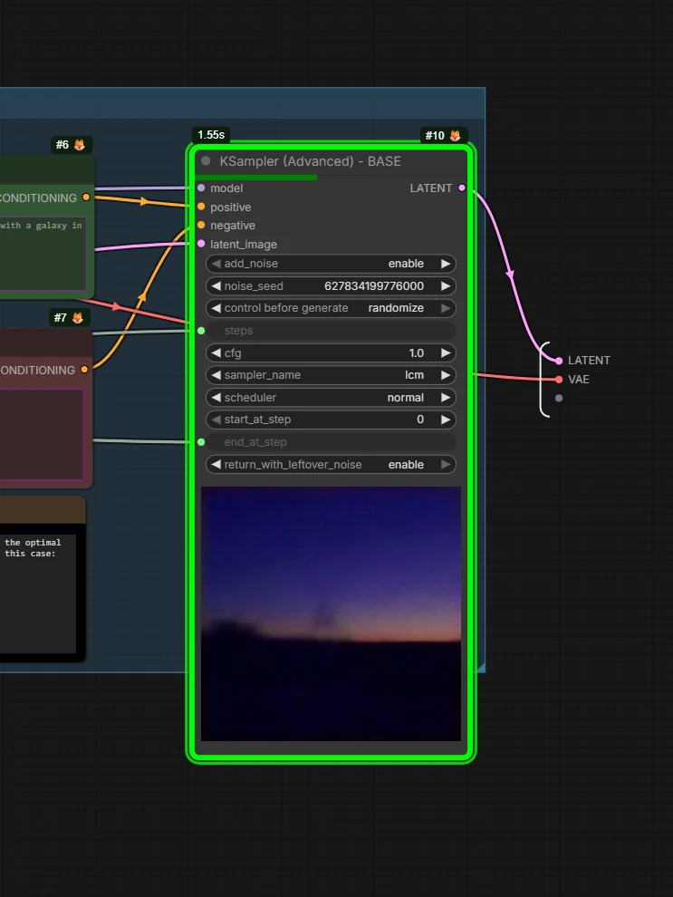

**Show executing node** (shown only while a workflow runs) jumps to the running node once, without following it.

---

### Graph Arrange

**Right-click the canvas > Arrange** to auto-layout the graph (or subgraph) you're viewing. Groups are kept together.

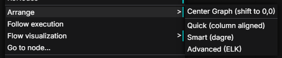

| Option | |
|--------|---|
| **Center Graph** | Moves everything back to the middle. Handy when you're lost in empty space. |
| **Quick** | Fast column layout |
| **Smart (dagre)** | Good balance of quality and speed |
| **Advanced (ELK)** | Best layout, fewest crossing links |

Result with **Advanced (ELK)**:

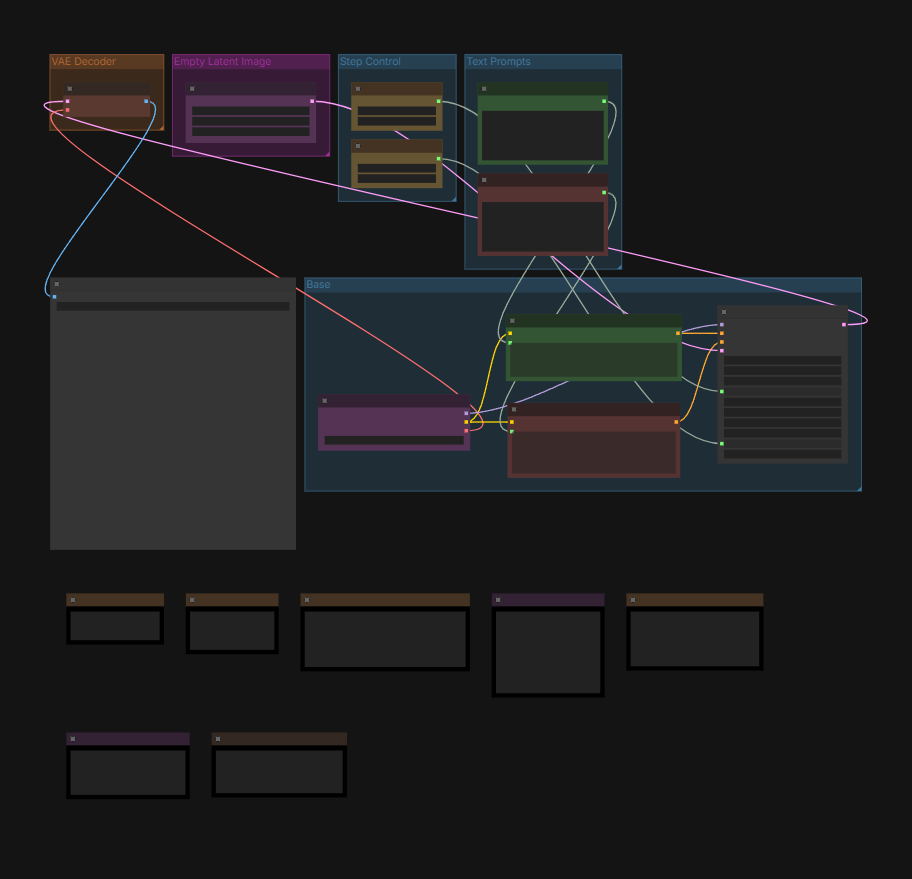

<details>
<summary>Before / after</summary>

**Before:**

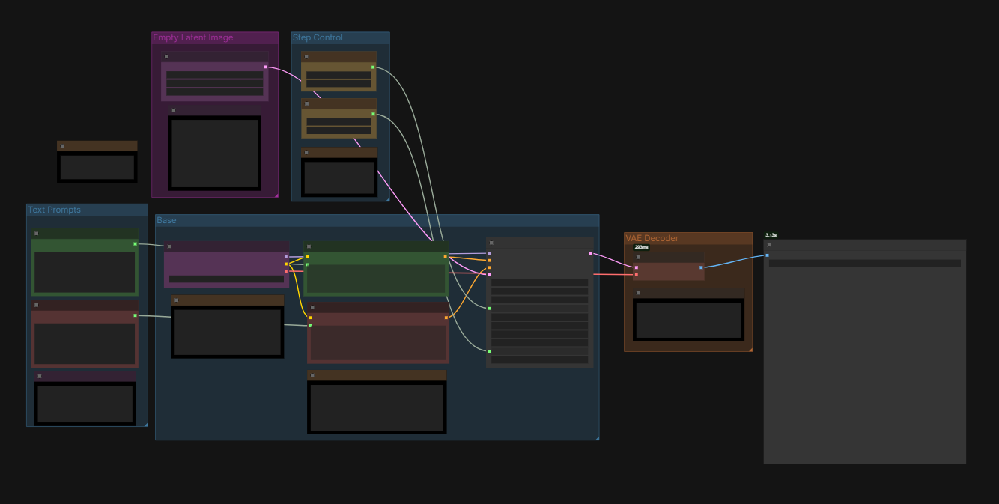

**After:**

<table>
<tr>
<td align="center"><strong>Quick</strong></td>
<td align="center"><strong>Smart (dagre)</strong></td>
<td align="center"><strong>Advanced (ELK)</strong></td>
</tr>
<tr>
<td>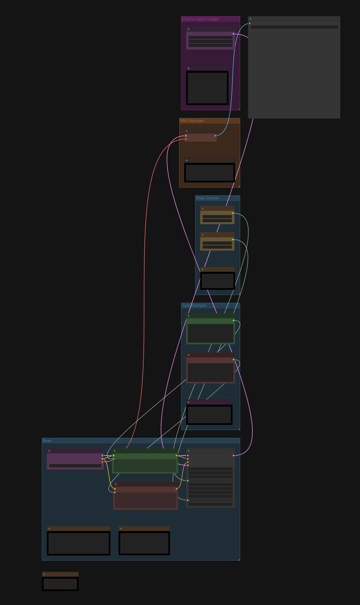</td>
<td>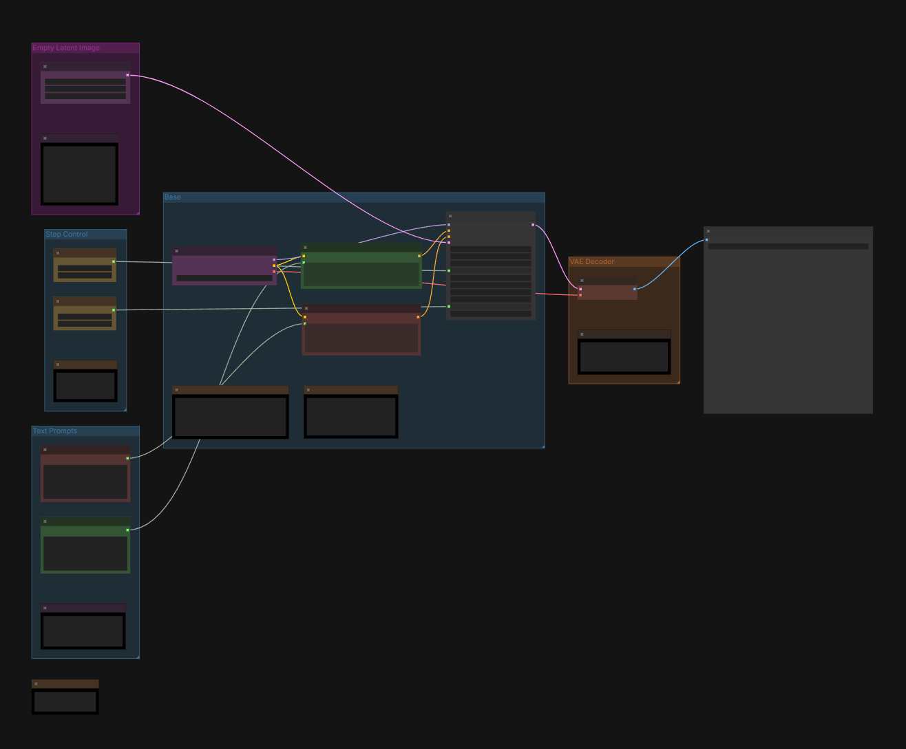</td>
<td></td>
</tr>
</table>

</details>

<details>
<summary>More details</summary>

- Nodes in a group are arranged inside it, then groups are arranged as blocks. Nested groups count as part of their outer group and are fitted around their own nodes afterwards. Empty groups keep their size.
- Nodes with no connections go in a grid below the graph (or inside their group, if they're in one).
- Arrange moves pinned nodes and groups too, and unpins them.
- Direction (left-to-right or top-to-bottom), spacing and group padding are in **Settings > EnhUtils > Arrange**.

</details>

---

### Play Sound

Plays a sound when the workflow reaches it, e.g. to tell you a long run has finished. Whatever you connect passes through unchanged.

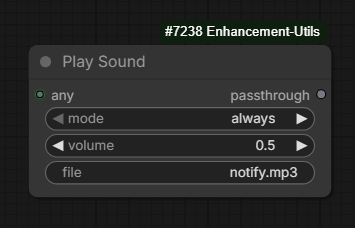

<details>
<summary>Inputs</summary>

| Input | Description |
|-------|-------------|
| any | Connect anything to trigger it; passed through to the output |
| mode | `always`, or `on empty queue` (only when the queue finishes) |
| volume | 0.0 - 1.0 |
| file | A file from `assets/` or a URL. Default: `notify.mp3` |

</details>

---

### System Notification

Shows a browser notification when the workflow reaches it. Whatever you connect passes through unchanged.

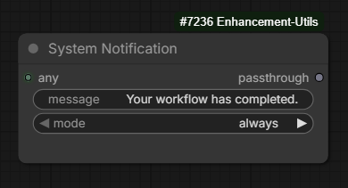

<details>
<summary>Inputs</summary>

| Input | Description |
|-------|-------------|
| message | The notification text |
| any | Connect anything to trigger it; passed through to the output |
| mode | `always` or `on empty queue` |

The browser asks for permission the first time you add the node.

</details>

---

### Parse JSON (EnhUtils)

Turns JSON text into data that other nodes can use. Handy with **Load Image (With Subfolders)** metadata, LLM output, and scripting nodes like [rgthree](https://github.com/rgthree/rgthree-comfy)'s Power Puter.

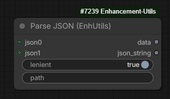

- Connect several JSON inputs to combine them.
- Use `path` to pick one value, e.g. `prompt.3.inputs.seed`.
- Forgiving: handles LLM-style output (code fences, trailing commas) and never stops the workflow on bad input.

<details>
<summary>Inputs, outputs and details</summary>

| Input | Description |
|-------|-------------|
| json0, json1, ... | JSON text. A new input appears as you connect each one (up to 10). |
| lenient | Fix up LLM-style output (default on) |
| path | A nested value to output, e.g. `workflow.nodes.0.type` or `items[2].name`. Empty = everything. |

| Output | Description |
|--------|-------------|
| data | The parsed data |
| json_string | The result as formatted JSON text |

**Combining inputs:** objects are merged (later inputs win), lists are joined end to end, a single input passes through as is. Mixing objects and lists is an error.

**Bad input:** empty or unconnected inputs are ignored. Invalid JSON, or a `path` that doesn't exist, shows a warning and is skipped. With nothing usable, the output is `{}`.

**Lenient mode** only kicks in when normal parsing fails. It removes markdown code fences and surrounding text, trailing commas, and accepts Python-style values (`'single quotes'`, `True`, `None`). It never runs code.

**Changed in v1.7.0:** the single `json_string` input became `json0`, `json1`, ... Reconnect old workflows to `json0`.

</details>

---

### Execution Gate (EnhUtils)

Skips the rest of a branch when a boolean is false -- without an error, and without running the nodes that feed it. For example: skip an expensive generation when an LLM's text fails a check. The queue keeps going, so auto-queue isn't interrupted.

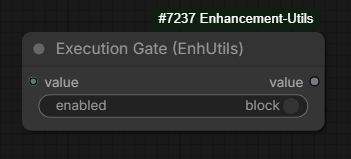

<details>
<summary>Inputs and details</summary>

| Input | Description |
|-------|-------------|
| enabled | `true` passes `value` through, `false` blocks |
| value | Anything. Only runs when `enabled` is true. |

| Output | Description |
|--------|-------------|
| value | `value` when enabled. When disabled, the nodes after it are skipped. |

When it blocks, you get a toast in the UI and a line in the server console.

**Compared to Impact Pack's Control Bridge (Stop mode):**
- Control Bridge is an output node, so everything before it always runs, even when its result is thrown away. The gate only runs if something after it needs it.
- When disabled, the nodes feeding `value` don't run at all.
- Uses only ComfyUI's built-in mechanisms, so it works inside subgraphs.

</details>

---

## Installation

Search for **Enhancement Utils** in the ComfyUI Manager, or clone it into `custom_nodes`:

```bash
cd ComfyUI/custom_nodes
git clone https://github.com/phazei/ComfyUI-Enhancement-Utils.git
pip install -r ComfyUI-Enhancement-Utils/requirements.txt
```

For NVIDIA GPU stats you need `nvidia-ml-py` (usually already installed with PyTorch):

```bash
pip install nvidia-ml-py
```

Don't install the package called `pynvml`; it's an outdated wrapper around `nvidia-ml-py`.

<details>
<summary>Dependencies</summary>

| Package | Required | Purpose |
|---------|----------|---------|
| `psutil` | Yes (comes with ComfyUI) | CPU, RAM and disk stats |
| `nvidia-ml-py` | Optional | NVIDIA GPU stats |
| `Pillow`, `torch`, `numpy` | Yes (come with ComfyUI) | Images |

Included JavaScript libraries (nothing to install): [dagre 0.8.5](https://github.com/dagrejs/dagre) and [elkjs 0.11.1](https://github.com/kieler/elkjs) for Graph Arrange.

</details>

<details>
<summary>Project structure (for developers)</summary>

```
ComfyUI-Enhancement-Utils/
├── __init__.py                    # V3 entrypoint (comfy_entrypoint)
├── pyproject.toml                 # Package metadata
├── nodes/                         # V3 nodes
│   ├── play_sound.py
│   ├── system_notification.py
│   ├── image_load_subfolders.py
│   ├── profiler_timing.py
│   ├── parse_json.py
│   └── execution_gate.py
├── monitor/                       # Resource monitor backend
│   ├── collector.py               # Background polling thread
│   ├── gpu.py                     # GPU stats
│   ├── hardware.py                # CPU / RAM / disk stats
│   └── routes.py                  # HTTP endpoints
├── profiler/                      # Execution timing + last-run record
│   ├── hooks.py
│   └── routes.py
├── src/                           # Vite/TypeScript build source
└── js/                            # Frontend (WEB_DIRECTORY)
    ├── utils.js                   # Shared subgraph / exec-id helpers
    ├── canvasMenu.js              # Shared canvas menu block
    ├── graphArrange.js            # Graph Arrange (menu, settings)
    ├── graphArrangeLayout.js      # Graph Arrange layouts (Quick, dagre, ELK)
    ├── nodeNavigation.js          # Go to node, Follow execution
    ├── nodeSearch.js, nodeSearchMatch.js, nodeSearch.css
    ├── flowGraph.js               # Flow Visualizer model
    ├── flowRun.js                 # Last run view + replay timeline
    ├── flowVisualizer.js          # Flow Visualizer overlay
    ├── nodeProfiler.js            # Timing badges
    ├── resourceMonitor.js, resourceMonitorGraph.js, resourceMonitor.css
    ├── playSound.js, systemNotification.js, executionGate.js, parseJson.js
    ├── assets/notify.mp3
    ├── built/                     # Vite output
    └── lib/                       # dagre, ELK
```

Nodes use the V3 schema (`comfy_api.latest`). Most frontend code is plain JavaScript; parts that need Vue are built from `src/` with Vite. See `AGENTS.md` for the details.

</details>

---

## More nodes by phazei

- **[Prompt Stash](https://github.com/phazei/ComfyUI-Prompt-Stash)** -- save and organise prompts in lists, capture an LLM's output straight into your stash, or pause the workflow to edit text before it continues.
- **[Multi LoRA Loader](https://github.com/phazei/ComfyUI-MultiLoRALoader)** -- stack any number of LoRAs in one tidy node: drag to reorder, drop files on it, see each LoRA's rank, and set per-layer strengths for LTX video and audio. Includes a cycle node for testing training checkpoints.
- **[Camera Path](https://github.com/phazei/ComfyUI-Camera-Path)** -- draw a camera move in a 3D editor and turn a single image into a reference video flying around the scene (uses ComfyUI's built-in MoGe).

## Support

If these tools save you some time, a tip on **[Ko-fi](https://ko-fi.com/phazei)** is always appreciated. Bug reports and ideas are welcome too.

<a href="https://ko-fi.com/phazei"></a>

---
## Acknowledgements

Rewritten and improved from:

- **[ComfyUI-Custom-Scripts](https://github.com/pythongosssss/ComfyUI-Custom-Scripts)** by pythongosssss -- Play Sound, System Notification, Go to Node, Follow Execution, arranging
- **[ComfyUI-Crystools](https://github.com/crystian/ComfyUI-Crystools)** by crystian -- Resource Monitor, image loading with metadata
- **[comfyui-profiler](https://github.com/aigc-apps/comfyui-profiler)** by aigc-apps -- node timing
- **[dagre](https://github.com/dagrejs/dagre)** (MIT) and **[elkjs](https://github.com/kieler/elkjs)** (EPL-2.0) -- layout libraries

## License

MIT. See [LICENSE](LICENSE).
